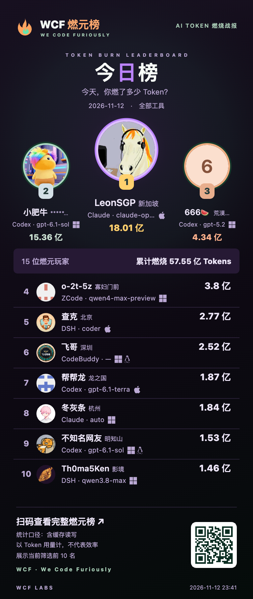

# TokTrail Collector

[English](README.md)

TokTrail Collector 是一个本地优先的 Go CLI，用于从受支持的本地开发工具中采集经过隐私过滤的 Token 使用元数据。

Collector 的设计目标是：即使没有账号，本地检查仍然可用。`scan`、`preview`、`export` 和诊断命令都可以离线运行；上传则需要显式设备绑定，并在每次上传前进行服务端 consent 预检。

## WCF 燃元榜

今天，你燃了多少 Token？用 TokTrail Collector 连接开发工具，在 **WCF 燃元榜**记录个人用量，看看社区里大家的 AI 使用情况。

**[查看实时榜单 →](https://tt.bjxdql.cn/)** · **[接入指引 →](https://tt.bjxdql.cn/setup)**

支持按时间、工具、模型和城市筛选，并可选择是否计入缓存读写。上传用量与公开上榜分别授权；本地扫描无需账号。

<details>
<summary>展开查看榜单分享卡片</summary>

<p align="center">
  <a href="https://tt.bjxdql.cn/">
    
  </a>
</p>

示例截图摄于 **2026-11-11**，最新排名与数据请查看[实时榜单](https://tt.bjxdql.cn/)。Token 用量不代表开发效率。

</details>

## 采集什么

当前实现支持：

- Codex session JSONL（`codex-jsonl`）。
- Claude Code session JSONL（`claude-code-jsonl`）。
- DeepSeek Harness session JSONL（`deepseek-harness`）。
- WorkBuddy AI session JSONL（`workbuddy-jsonl`）：仅被动读取 JSONL。
- Qwen Code / Qwen CLI chat JSONL（`qwen-jsonl`）：仅被动读取 `api_response`/`usageMetadata` 计数。
- Kimi CLI wire JSONL（`kimi-cli-jsonl`）：仅读取 `StatusUpdate.token_usage` 计数。
- Kimi Code wire JSONL（`kimi-code-jsonl`）：仅读取 turn 级 `usage.record` 计数。
- ZCode SQLite（`zcode-sqlite`）：仅读取 `model_usage` 用量表。
- Hermes Agent SQLite（`hermes-sqlite`）：仅读取 `state.db` 的用量表。
- OpenClaw SQLite（`openclaw-sqlite`）：仅读取 `transcript_events.event_json` 用量事件。
- Pi session JSONL（`pi-jsonl`）：仅读取 assistant message 与 usage/model_usage 条目计数。
- Oh My Pi session JSONL（`omp-jsonl`）：与 Pi 相同格式，读取 `~/.omp` 下的会话。
- CodeBuddy IDE 会话历史（`codebuddy-history`）：被动读取 CodeBuddy IDE 本地数据目录下 `index.json` 的每请求用量计数，并从 messages 文件解析记录的模型标识与旧版本的轮次时间戳；仅采集已完成请求，不读取对话正文。
- OpenCode CLI 会话 SQLite（`opencode-sqlite`）：被动读取 `~/.local/share/opencode/opencode.db` 中 assistant 消息的用量计数；不读取消息正文。
- 用于集成与兼容测试的合成/自由格式 `usage-json`。

Collector 上传 Token 使用计数、稳定的隐私安全记录标识，以及下文说明的各采集源模型标识。它不得上传 prompt、消息正文、原始 session ID、原始 message ID 或本地绝对路径。

## 隐私与授权模型

TokTrail Collector 将三类权限分开：

1. **本地读取授权**：计划采集可以读取哪些本地路径。
2. **上传 consent**：绑定设备是否可以向 TokTrail 兼容服务上传使用记录。
3. **公开榜单 consent**：投影后的使用数据是否可以公开展示。

关键约束：

- `scan`、`preview`、`export` 不需要 TokTrail 账号。
- 计划采集只读取通过 `sources` 或 `service install --grant` 显式启用的路径。
- 没有任何 source grant 时，计划任务不扫描也不联网。
- `sync` 上传前会先调用 `GET /v1/devices/self`，并把当次快照中的 consent revision 随 ingest 请求提交。
- 未知 Token 计数保持未知，不会被静默转成 0。
- 可可靠归属的历史模型标识会原样保留并上传，包括私有名称和本地别名；缺失或归属不明确时使用 `unknown`。非法标识会报告，不会静默改写。标识应为非空 UTF-8 字符串，不超过 128 字节且不含控制字符。Collector 不推测别名背后的模型；公开展示由 leaderboard 控制。

## 仓库结构

```text
cmd/toktrail/            主 Collector CLI
cmd/toktrail-installer/  用户安装与验签入口
cmd/toktrail-release/    维护者 CLI 与旧命令兼容入口
scripts/release.sh      本地与 CI 共用的构建编排
.github/workflows/      测试与 tag 触发的自动发布
tools/release/          归档组装、签名、bootstrap 模板和发行 E2E
internal/source/
  adapter/              共享记录契约、校验、Token 与隐私辅助逻辑
  jsonl/                共享 JSONL 文件发现、逐行读取和解码
  usagejson/            usage-json parser 与测试
  codexjsonl/            Codex parser、重放过滤与测试
  claudecodejsonl/       Claude Code parser、区间完整性与测试
  deepseekharness/       DeepSeek Harness parser 与测试
  workbuddyjsonl/        WorkBuddy JSONL parser 与测试
  qwenjsonl/             Qwen Code / Qwen CLI JSONL parser 与测试
  kimiwire/              Kimi CLI / Kimi Code wire JSONL parser 与测试
  zcodesqlite/           ZCode SQLite parser 与测试
  hermessqlite/          Hermes Agent SQLite parser 与测试
  openclawsqlite/        OpenClaw SQLite parser 与测试
  piwire/                Pi / Oh My Pi session JSONL parser 与测试
  registry/             显式编译期 adapter 注册表
  pipeline/             扫描、预览、导出与批次拆分
internal/local/         本地状态、授权、outbox、commit、进度、锁与隔离区
internal/app/           应用工作流：采集、诊断与状态
internal/bind/          设备绑定
internal/connect/       一键连接编排流程
internal/syncclient/    服务端同步、ACK、重组与恢复
internal/distribution/  manifest、版本、签名、哈希与命名协议
internal/installer/     下载、验签、解包与安全替换二进制
internal/scheduler/     launchd、systemd user timer、Windows Task Scheduler 计划
docs/                   架构、发布与调度设计说明
```

依赖边界和新增数据源的方法见 [Architecture and adapter extension](docs/ARCHITECTURE.md)。

## 常用命令

- `toktrail version` 输出 Collector 版本。
- `toktrail help` 输出可用命令。
- `toktrail connect '<URL>'` 通过一键连接 URL/ticket 绑定设备、应用本次授权、安装定时服务，并重新同步授权范围内的用量。
- `toktrail scan` 离线汇总本地记录。
- `toktrail preview` 校验并预览本地记录。
- `toktrail export` 写出 server ingest batch，并登记到本地 outbox。
- `toktrail bind` 生成或复用本地 device secret，并用服务端一次性 ticket 绑定设备。
- `toktrail status` 检查当前绑定设备状态。
- `toktrail sync` 上传指定 batch 或最旧的 pending outbox batch。
- `toktrail resync --all --dry-run` 离线预览已同步设备归档中符合本地授权的批次，不联网、不修改状态；预览仅涵盖归档，不扫描来源或隔离区，也不验证远端授权。
- `toktrail resync --all` 确认后扫描已授权来源、恢复本次范围内的隔离记录、上传待同步批次并重传历史归档；已启用 Cursor 时也会同步当前授权的完整时间范围。`--yes` 跳过交互，`--max-batches N` 限制本次归档重传批次；未完成的工作会明确提示，可再次执行续传。
- `toktrail resync --all --force-recollect --dry-run` 读取服务端当前设备授权与重置计划，使用空基线预扫全部已启用、已授权本地来源。它与普通 resync 的离线 dry-run 不同：会进行只读网络请求和临时隔离扫描，但不会清空或上传。
- `toktrail resync --all --force-recollect` 经明确确认后清空本设备之前的普通工具采集历史，并按当前授权从原始来源重新采集。保留设备身份、凭据及 Cursor 账号状态；授权范围外或原始日志已不存在的旧历史不会恢复。先核对计划再确认；可用 `--expected-device ID` 防止在错误设备执行，`--max-batches N` 限制本次上传数量。中断后执行同一命令续传，同一任务不会再次清空服务端。需要服务端与网站支持 `device-usage-reset`；旧客户端和旧状态备份不能把旧代次错误批次回灌。命令成功表示服务端重采完成，网站投影随后异步更新。若记录被服务端拒绝，已结算的拒绝批次不能靠反复续传纠正：先修复原因，再仅移除当前状态目录下 `force-recollect.json` 放弃未完成任务，重新明确确认一次强制重采；保留已安装的新代次状态及隔离归档，绝不恢复旧批次。
- 本次有效授权决定上传范围；范围收窄不会删除服务器已有历史，撤销和删除由 leaderboard 负责。缺失的源数据或归档无法可靠重建；跨设备去重不受保证，重新安装时应保留本地状态目录。
- `toktrail sources` 管理计划采集的显式本地读取授权。
- `toktrail periodic` 从已启用 grants 采集，并有限度 drain pending batches。
- `toktrail service` 安装或卸载用户级计划任务。
- `toktrail privacy` 与 `toktrail doctor` 提供本地诊断。

## 命令输出与日志

- `connect`、`periodic`、`resync` 默认输出简洁英文状态：只打印阶段结论与最终结果行（含未完成原因与可观测的待处理事实），不输出逐批次明细。默认输出、`--verbose` 明细与帮助文本都不包含票据、服务器 URL、本地路径或设备/主体标识；错误按固定文案呈现，不回显原始错误文本。
- `--verbose` 仅让本次运行额外输出详细阶段日志（计数与固定状态码）。它不改变任何同步、上传或授权行为，也不采集更多数据，退出码与默认模式一致。
- `connect` 与 `periodic` 支持 `--json`：stdout 恰好输出一个机器可读结果对象（失败路径同样输出），人类可读文本移至 stderr，退出码与不带 `--json` 时一致。两者另支持 `--progress-json`：进度事件以 JSON Lines 写入 stderr；stderr 可能同时混有人类可读文本与交互提示，消费方必须按事件中的 `"type":"collection_progress"` 字段筛选，不能把每一行都当作事件解析。`resync` 没有这两个机器输出标志。
- 对外分享日志前请先检查内容：终端回显、重定向输出或截图可能带有时间戳、主机名、目录名等环境元数据，确认没有超出预期的信息再分享。

## 本地开发快速开始

构建并查看 CLI：

```sh
go run ./cmd/toktrail version
go run ./cmd/toktrail help
```

扫描并导出 Codex 使用数据：

```sh
go run ./cmd/toktrail scan --source codex-jsonl --input ~/.codex/sessions
go run ./cmd/toktrail export --source codex-jsonl --input ~/.codex/sessions --out ./codex-batch.json --batch codex-demo-1
```

Codex 使用统一的流式 JSONL 字段投影：大型正文、图片和工具输出只流式验证，不完整载入内存，不再受共享读取器的 16 MiB 单行限制。模型、时间与用量校验，以及原物理行号和去重键保持不变；损坏日志仍明确报错，不会静默跳过。无需设置行大小参数。

扫描并导出 Claude Code 使用数据：

```sh
go run ./cmd/toktrail scan --source claude-code-jsonl --input ~/.claude/projects
go run ./cmd/toktrail export --source claude-code-jsonl --input ~/.claude/projects --out ./claude-batch.json --batch claude-demo-1
```

扫描并导出 DeepSeek Harness 使用数据：

```sh
go run ./cmd/toktrail scan --source deepseek-harness --input ~/.dsh/sessions
go run ./cmd/toktrail export --source deepseek-harness --input ~/.dsh/sessions --out ./deepseek-batch.json --batch deepseek-demo-1
```

扫描并导出 WorkBuddy 使用数据：

```sh
go run ./cmd/toktrail scan --source workbuddy-jsonl --input ~/.workbuddy-ai/projects
go run ./cmd/toktrail export --source workbuddy-jsonl --input ~/.workbuddy-ai/projects --out ./workbuddy-batch.json --batch workbuddy-demo-1
```

扫描并导出 Qwen Code / Qwen CLI 使用数据：

```sh
go run ./cmd/toktrail scan --source qwen-jsonl --input ~/.qwen/projects
go run ./cmd/toktrail export --source qwen-jsonl --input ~/.qwen/projects --out ./qwen-batch.json --batch qwen-demo-1
```

Qwen 说明：

- 该 source 仅被动读取 Qwen Code / Qwen CLI chat JSONL，不读取运行中 session IPC token、设置、凭据或正文之外的目录。
- 新版优先读取 `systemPayload.uiEvent.event.name = "qwen-code.api_response"` 的遥测计数；若某个文件没有该事件，才回退读取 `assistant.usageMetadata`，避免同一次主调用被双重统计。
- `promptTokenCount` / `input_token_count` 包含 cache read；Collector 上传时拆成净 input 与 `cacheRead`。Qwen 日志未可靠暴露 cache write，首版记录为 `0`，不从价格或 prompt 差额反推。
- 默认目录是 `~/.qwen/projects`；旧版 `~/.qwen/tmp/...` 布局和 `~/.qwen/usage*.jsonl` 台账尚未作为权威来源启用，需后续真实样本验证。

扫描并导出 Kimi CLI 使用数据：

```sh
go run ./cmd/toktrail scan --source kimi-cli-jsonl --input ~/.kimi/sessions
go run ./cmd/toktrail export --source kimi-cli-jsonl --input ~/.kimi/sessions --out ./kimi-cli-batch.json --batch kimi-cli-demo-1
```

扫描并导出 Kimi Code 使用数据：

```sh
go run ./cmd/toktrail scan --source kimi-code-jsonl --input ~/.kimi-code/sessions
go run ./cmd/toktrail export --source kimi-code-jsonl --input ~/.kimi-code/sessions --out ./kimi-code-batch.json --batch kimi-code-demo-1
```

Kimi 说明：

- Kimi CLI 和 Kimi Code 分别注册为 `kimi-cli-jsonl` 与 `kimi-code-jsonl`，默认目录分别是 `~/.kimi/sessions` 与 `~/.kimi-code/sessions`，不假设两者完全兼容。
- Kimi CLI 仅读取 `wire.jsonl` 中的 `StatusUpdate.token_usage`；Kimi Code 仅读取 turn 级 `usage.record`，跳过 session 级累计记录以避免重复计数。
- 计数映射为 `input_other`/`inputOther` → `input`，`input_cache_read`/`inputCacheRead` → `cacheRead`，`input_cache_creation`/`inputCacheCreation` → `cacheWrite`，`output` → `output`。
- Kimi Desktop 内置运行时路径和其它归档目录尚未作为默认授权路径；如需采集，需先用真实样本单独验证后显式授权。

扫描并导出 ZCode 使用数据：

```sh
go run ./cmd/toktrail scan --source zcode-sqlite --input ~/.zcode/cli/db
go run ./cmd/toktrail export --source zcode-sqlite --input ~/.zcode/cli/db --out ./zcode-batch.json --batch zcode-demo-1
```

ZCode 说明：

- 该 source 仅读取 ZCode 本地 SQLite 的 `model_usage` 表；默认授权目录是 `~/.zcode/cli/db`，目录内每个 `*.sqlite` 都会被读取。
- `input_tokens` 已包含 cache read/write，Collector 上传时拆成净 `input`、`cacheRead`、`cacheWrite`。
- 为避免写入 live SQLite 目录，读取使用只读 immutable DSN；刚写入 WAL 且尚未 checkpoint 的记录可能要到下一次采集才可见。
- `rollout/model-io-*.jsonl`、`usage-archive.sqlite`、`history-freeze.sqlite` 等归档/补偿来源尚未纳入首版，需真实样本验证后再决定是否扩展。

扫描并导出 Hermes Agent 使用数据：

```sh
go run ./cmd/toktrail scan --source hermes-sqlite --input ~/.hermes
go run ./cmd/toktrail export --source hermes-sqlite --input ~/.hermes --out ./hermes-batch.json --batch hermes-demo-1
```

Hermes 说明：

- 该 source 仅读取 Hermes Agent 本地 `state.db` 的 `session_model_usage` 用量表；旧 schema 缺少该表时回退读取 `sessions` 汇总计数。
- Hermes 的计数是会话/模型累计快照，Collector 以 `kind="cumulative"` 上传，交由服务端按稳定 group/reset 计算差分。
- 默认授权目录是 `~/.hermes`；多 profile 目录（如 `~/.hermes/profiles/<name>/state.db`）首版不会自动递归，需要真实样本验证后显式授权。
- 不读取 `auth.json`、`messages`、FTS 表、日志或 legacy session JSONL，避免接触凭据和正文。

扫描并导出 OpenClaw 使用数据：

```sh
go run ./cmd/toktrail scan --source openclaw-sqlite --input ~/.openclaw/agents
go run ./cmd/toktrail export --source openclaw-sqlite --input ~/.openclaw/agents --out ./openclaw-batch.json --batch openclaw-demo-1
```

OpenClaw 说明：

- 该 source 递归查找 `openclaw-agent.sqlite`，仅读取 `transcript_events.event_json` 中带 `usage` 的事件。
- 默认授权目录是 `~/.openclaw/agents`；旧版 JSONL 与 legacy/archive artifacts 不作为首版权威来源。
- 首版不解码 `event_zstd` 压缩事件；发现压缩行时会本地报告跳过，需后续加入 zstd 解码后再覆盖。
- 不读取 credentials、控制面状态或不含用量的对话正文表；记录只上传计数、模型、时间和脱敏事件标识。

扫描并导出 Pi 使用数据：

```sh
go run ./cmd/toktrail scan --source pi-jsonl --input ~/.pi/agent/sessions
go run ./cmd/toktrail export --source pi-jsonl --input ~/.pi/agent/sessions --out ./pi-batch.json --batch pi-demo-1
```

扫描并导出 Oh My Pi 使用数据：

```sh
go run ./cmd/toktrail scan --source omp-jsonl --input ~/.omp/agent/sessions
go run ./cmd/toktrail export --source omp-jsonl --input ~/.omp/agent/sessions --out ./omp-batch.json --batch omp-demo-1
```

Pi / Oh My Pi 说明：

- Pi（badlogic/pi-mono，现 earendil-works/pi）与 Oh My Pi（omp，can1357 fork）写相同的 JSONL 会话格式；两者注册为 `pi-jsonl` 与 `omp-jsonl` 两个独立 source，默认目录分别是 `~/.pi/agent/sessions` 与 `~/.omp/agent/sessions`。
- 会话文件是追加式树（首行 header + 带 id/parentId/timestamp 的 entry）。Collector 读取 assistant message 的 `usage` 以及独立的 `usage` / `model_usage` 条目（omp 的标题生成等会话外调用），每条为一次独立请求的 delta。
- usage 四个桶为 `input`/`output`/`cacheRead`/`cacheWrite`（OpenAI 约定，互不相交，input 不含 cache），Collector 原样上传不做加减；`reasoningTokens` 是 output 的信息性子集，不单独上传。
- 两个产品共用同名环境变量 `PI_CODING_AGENT_DIR`/`PI_CODING_AGENT_SESSION_DIR`；为避免同一目录被两个 source 各扫一遍造成双计，首版不读取这些环境变量，只用固定默认路径。
- /fork 复制活动分支到新会话文件时可能重复计入历史请求；分支/重置语义需真实样本验收。omp 的 profile 目录（`~/.omp/profiles/<name>/agent/sessions`）首版不自动发现，需显式授权。

扫描并导出 CodeBuddy 使用数据：

```sh
# POSIX（XDG）：$XDG_DATA_HOME/CodeBuddyExtension/Data，默认 ~/.local/share/CodeBuddyExtension/Data
go run ./cmd/toktrail scan --source codebuddy-history --input "${XDG_DATA_HOME:-$HOME/.local/share}/CodeBuddyExtension/Data"
go run ./cmd/toktrail export --source codebuddy-history --input "${XDG_DATA_HOME:-$HOME/.local/share}/CodeBuddyExtension/Data" --out ./codebuddy-batch.json --batch codebuddy-demo-1

# Windows
go run ./cmd/toktrail scan --source codebuddy-history --input "$HOME/AppData/Local/CodeBuddyExtension/Data"
go run ./cmd/toktrail export --source codebuddy-history --input "$HOME/AppData/Local/CodeBuddyExtension/Data" --out ./codebuddy-batch.json --batch codebuddy-demo-1
```

CodeBuddy 说明：

- CodeBuddy 为每个会话写一个会话索引（`history/<project>/<conversationId>/index.json`）。只有被证实为会话的索引才会读取：位于该 `history/<project>/<conversationId>` 层级，或与 `messages` 目录同级。工作区级会话列表（`history/<project>/index.json`）、`current.json`、`recent.json` 不会被当作用量读取。
- `requests[]` 中每个条目是一次用户请求，按 `delta` 记录上传。`inputTokens` 是该轮请求的总 prompt，真实数据按三路拆分：`cacheTokens`（cache 读）+ `cachedWriteTokens`（cache 写）+ `cachedMissTokens`（未命中）= `inputTokens`。上传时未命中部分作为 `input`、`cacheTokens` 作为 `cacheRead`、`cachedWriteTokens` 作为 `cacheWrite`，三个桶相加正好等于记录的 prompt。`totalTokens` 必须等于 `inputTokens + outputTokens`，记录的拆分不得超过 `inputTokens`，非 0 的 `cachedMissTokens` 必须使三路之和精确等于 `inputTokens`；旧格式若缺少 `cacheTokens` 或 `cachedWriteTokens`（包括字段为 `null`），不能由此推断无缓存，该请求继续隔离；仅记录部分缓存字段的行也隔离，避免丢失已知缓存份额。
- 只采集记录为 `complete` 的请求；进行中的请求会发布部分用量快照、已取消的请求缺少 `startedAt`，两者都跳过，绝不导出仍在增长的计数；自相矛盾的计数（缓存大于 prompt、total 与 prompt+output 不符、小数或负数）会把该请求置入隔离区，而不是上传。
- `startedAt`（毫秒级，兼容秒级）是唯一认可的时间来源：缺少有效 `startedAt` 的请求会被隔离，而不是用消息文件的修改时间兜底（备份恢复和普通拷贝都会改写该时间）。
- 较早会话还会留下 `{"inputTokens":null,...}` 的占位 usage 行（表示该轮未记录计数）。这类行不产生用量，静默跳过，不进入隔离区。
- 模型标识不在 `index.json` 中，而是从消息文件读取 `extra.modelId`：仅当该轮所有指认本次 `extra.requestId` 的 assistant message 都记录同一模型时才归属成功；若该轮没有单独的 assistant message，客户端会把模型记在唯一的那条 user message 上，此时仅当该消息自身的 `extra.requestId` 等于本次请求 id 才作为兜底来源。模型混杂、无法归属或不可读取时上报 `unknown` 并附本地无值诊断，绝不猜测，用量照常导出。每个请求最多探测 64 个消息文件；列表超出预算时整轮模型为 `unknown`，不会只读尾部消息就推断整轮归属。只有目录级授权才读取消息文件，单文件授权只读该索引。
- 默认目录按平台取：POSIX 主机为 XDG 数据目录（`XDG_DATA_HOME` 为绝对路径时取 `$XDG_DATA_HOME/CodeBuddyExtension/Data`，否则取 `~/.local/share/CodeBuddyExtension/Data`）；Windows 为 `~/AppData/Local/CodeBuddyExtension/Data`。两种布局都会探测（先 XDG 后 AppData），因此托管授权不会指向本机不存在的目录。与之都不同的自定义布局需显式授权到包含会话索引文件的目录。

WorkBuddy 说明：

- 该 source 仅被动读取 JSONL：只读 WorkBuddy 追加写入的 session JSONL 文件，绝不写入。
- 不覆盖 WorkBuddy 的 SQLite 历史库；只存在于 SQLite 中的用量不会被采集。
- 可以可靠归属的历史请求模型标识会随用量上传，但不代表已验证其后端模型身份。
- 默认优先探测 `~/.workbuddy-ai/projects`，仅当其不存在时自动回退至 `~/.workbuddy/projects`；`connect` 和定时 grant 同步均支持这两种布局，不会自动合并两个目录。Windows 下 `~` 对应当前运行账户的用户目录。
- 定时 grant 同步保留已有的默认布局授权和手动禁用状态。`connect` 仍会重新应用当前授权；非标准或自定义路径可在 `connect` 后通过 `toktrail sources enable --source workbuddy-jsonl --input <path>` 显式添加，并在重新连接后检查。

绑定并同步到本地开发服务：

```sh
TOKTRAIL_BIND_TICKET=dev-ticket go run ./cmd/toktrail bind \
  --server http://127.0.0.1:3211 \
  --application leaderboard-local \
  --subject demo-user \
  --device-name my-mac

TOKTRAIL_BIND_TICKET=dev-ticket go run ./cmd/toktrail status \
  --server http://127.0.0.1:3211

go run ./cmd/toktrail sync --server http://127.0.0.1:3211
```

`TOKTRAIL_BIND_TICKET=dev-ticket` 只是本地占位符。生产部署应通过自己的账号和接入流程发放一次性 bind ticket。

## 计划采集

计划采集需要显式开启。本地启用 source grants 后再安装用户级任务：

```sh
go run ./cmd/toktrail service install \
  --grant codex-jsonl=$HOME/.codex/sessions \
  --grant claude-code-jsonl=$HOME/.claude/projects \
  --grant deepseek-harness=$HOME/.dsh/sessions \
  --grant workbuddy-jsonl=$HOME/.workbuddy-ai/projects \
  --grant qwen-jsonl=$HOME/.qwen/projects \
  --grant kimi-cli-jsonl=$HOME/.kimi/sessions \
  --grant kimi-code-jsonl=$HOME/.kimi-code/sessions \
  --grant zcode-sqlite=$HOME/.zcode/cli/db \
  --grant hermes-sqlite=$HOME/.hermes \
  --grant openclaw-sqlite=$HOME/.openclaw/agents \
  --grant pi-jsonl=$HOME/.pi/agent/sessions \
  --grant omp-jsonl=$HOME/.omp/agent/sessions \
  --grant codebuddy-history=$HOME/.local/share/CodeBuddyExtension/Data \
  --grant opencode-sqlite=$HOME/.local/share/opencode \
  --interval 30m
```

安装后的任务只运行：

```text
<toktrail binary> periodic --state-dir <absolute state dir>
```

调度器命令行上不会出现 server URL 或 secret。完整模型与平台说明见 [Scheduled collection](docs/SCHEDULING.md)。Windows 使用随包的 `toktrail-background.exe` 无窗口启动采集；已有任务在安装完整新版后运行 `toktrail service refresh` 迁移，不需要重新绑定或授权。详见 [Windows 10/11 测试方案](docs/WINDOWS_BACKGROUND_TEST_PLAN.zh-CN.md)。

## 签名发布与安装

GitHub Actions 和 `scripts/release.sh` 编排六平台构建；维护者工具负责归档与签名；独立安装器负责验签、SHA-256 校验和安全替换。Tag workflow 在完成所配置的环境审批、签名和验签后自动发布 GitHub Release；预发布 tag 会标为预发布且不会成为 Latest。安装器与 bootstrap 脚本另支持显式原位 `upgrade`：复用原安装路径、默认保留旧版二进制为 `<binary>.previous`，不触碰 state/grants/outbox、设备绑定与调度注册，也不重新接入。详见 [Release and installation](docs/RELEASE.md)。

生产运营方需要自行提供发布签名密钥、可信公钥分发渠道、下载托管，以及所需的平台公证或代码签名。

## 开发检查

提交前运行：

```sh
gofmt -l cmd internal tools
GOPROXY=off go test ./...
GOPROXY=off go vet ./...
```

较慢的 release E2E 测试需要显式开启：

```sh
GOPROXY=off TOKTRAIL_RELEASE_E2E=1 go test ./tools/release/ -run '^TestEndToEndRelease$' -count=1 -v
```

## Cursor 账号用量采集

在网站安装流程中选择 Cursor 后，`toktrail connect` 会整合首次本机授权，复用桌面端已有登录；不需要再执行一套 Cursor 登录流程。采集器直接查询 Cursor 个人用量接口，只向 TokTrail 上传脱敏事件与计数，不上传登录凭据、原始账号 ID、邮箱或聊天内容。

```sh
toktrail cursor enable
toktrail cursor status
toktrail cursor sync
toktrail cursor logout
```

桌面登录状态无法读取时，可以通过受保护的管道或文件输入执行 `toktrail cursor enable --token-stdin --confirm-local`；已有有效许可时可用 `toktrail cursor sync --token-stdin`。Token 不作为命令参数，也不保存到配置中；仅在本次进程内复用，终端明文输入会被拒绝。默认后台任务继续使用桌面登录状态。

同一用户的账号事件跨采集设备去重，重复快照不累加；修正值按修订号替换，支持下调。普通拉取保留重叠窗口，并每日完整核对授权范围内的历史。缺失计数保持未知，不用费用推算 Token。

部署时先升级 Server 与账号投影，再发布带 schema-2 签名能力声明的 Collector，最后启用网站运营开关。详细流程、隐私边界与限制见 [Cursor 接入说明](docs/CURSOR-ACCOUNT-COLLECTION.md)。

## Cursor 采集已知局限（账号级网络来源）

- 桌面登录状态以只读方式读取（SQLite `mode=ro`，只查认证键）；凭据仅存于内存，不落盘、不进日志与上传。
- WAL 模式使用 `immutable` 只读，仅访问已 checkpoint 的主库内容；刚完成的登录可能仅存在于 WAL 中，需要 Cursor 正常关闭并 checkpoint 后再重试。
- 无人值守调度任务不会发起首次授权：通常由 connect 或 `toktrail cursor enable` 交互确认；受保护管道的手动备用模式必须显式指定 `--confirm-local`。
- 账号级统计由 Cursor 服务端汇总，可能包含该账号在其他电脑上的使用；首版仅支持每个用户一个 Cursor 账号来源、一台指定采集设备，接管由网站重新指定，collector 不自动抢占。

## 贡献与安全

- 开发规范和 PR 检查见 [CONTRIBUTING.md](CONTRIBUTING.md)。
- 报告漏洞或隐私问题前请先阅读 [SECURITY.md](SECURITY.md)。

## 许可证

MIT。见 [LICENSE](LICENSE)。
